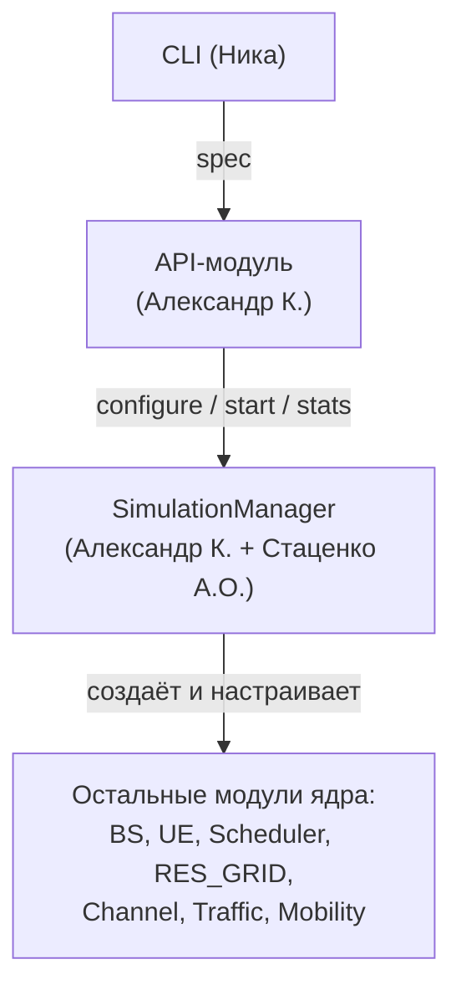
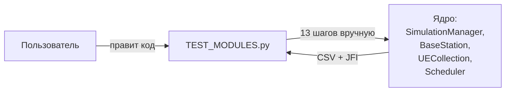
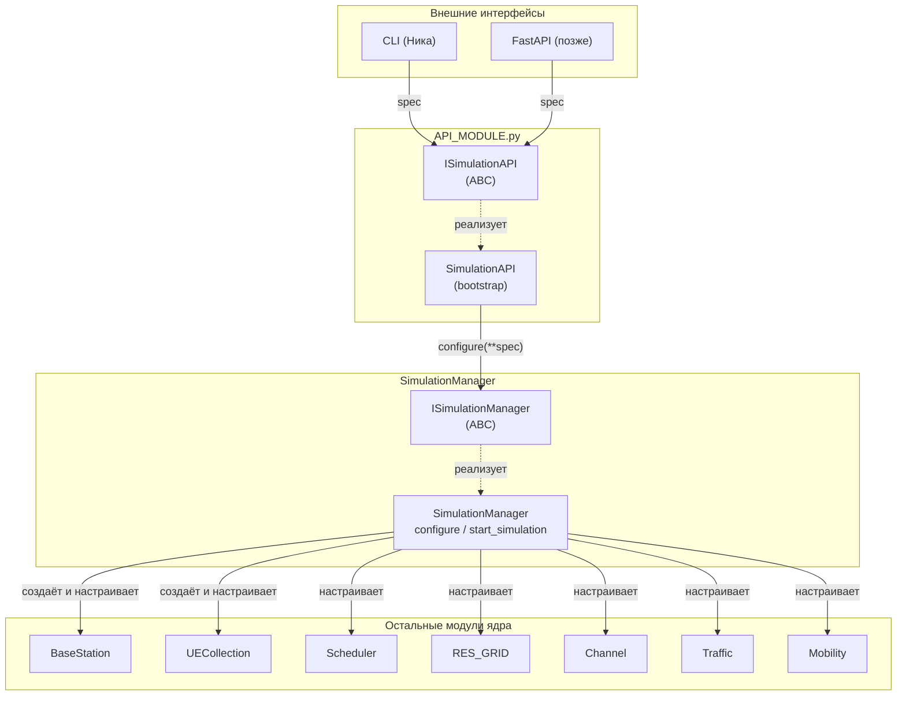
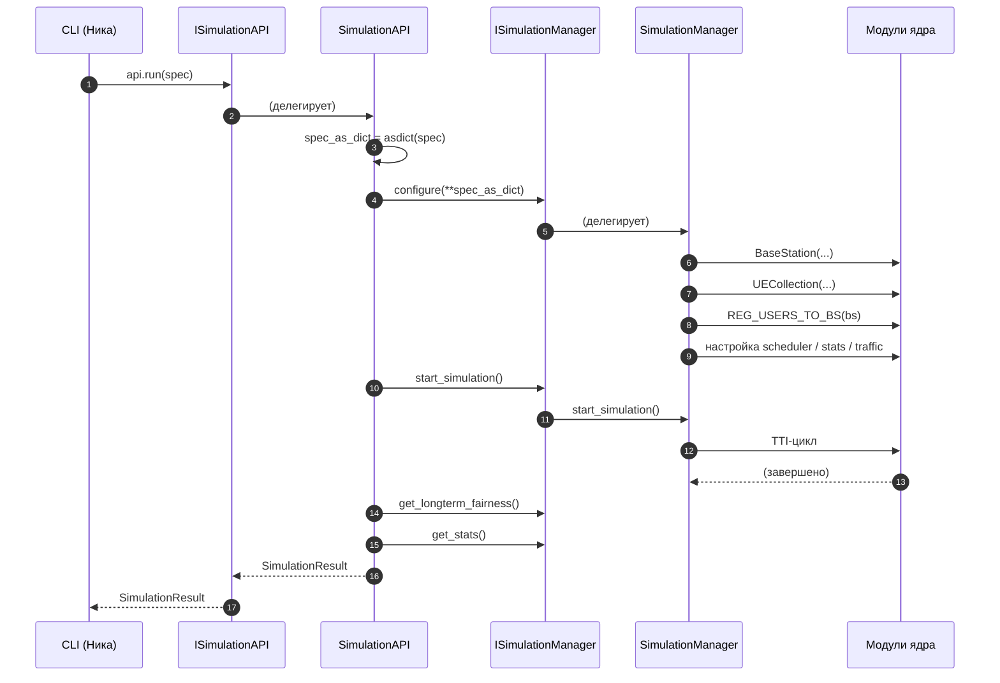

# SPEC-FEAT-API-001 — API-модуль: контракт и интерфейсы

> Ответственный: Александр К. (ziggy-ak (GitHub))
> Статус: черновик (техническое проектирование)
> Обновлено: `25-10-2025`
> Связано: планёрка (17.10.2026), планёрка (24.10.2026)

## 1. Назначение

API-модуль — прослойка между ядром симулятора и внешними интерфейсами
(CLI, FastAPI, скрипты). Принимает `SimulationSpec`, запускает ядро
через `SimulationManager`, возвращает `SimulationResult`.

**Ключевое требование (курс команды):** API работает через
**ABC-интерфейсы**, а не через конкретные классы. API сам предоставляет
интерфейс для CLI и требует интерфейс от `SimulationManager`.

**Архитектурная цепочка:**



**Следствие:** API импортирует **только `SIMULATION_MANAGER`**. Ни
`BS_MODULE`, ни `UE_MODULE`, ни `SCHEDULER`, ни `RES_GRID` — не
импортирует. Сборкой ядра занимается `SimulationManager`.

## 2. Архитектура

### 2.1. AS-IS (как сейчас)



Проблемы: параметры захардкожены, CLI не может вызвать, FastAPI не
может обернуть, рефакторинг ядра ломает `TEST_MODULES`.

### 2.2. TO-BE (как будет)



### 2.3. Поток выполнения



## 3. Интерфейс API (что видит CLI)

`ISimulationAPI` — **единственный интерфейс, который создаёт API**.
Публичный контракт для CLI и FastAPI. Код приводится целиком, потому
что это зона автора.

```python
from abc import ABC, abstractmethod
from typing import List

class ISimulationAPI(ABC):
    """Интерфейс API-модуля. Через него работают CLI, FastAPI, скрипты."""

    @abstractmethod
    def run(self, spec: SimulationSpec) -> SimulationResult: ...

    @abstractmethod
    def validate(self, spec: SimulationSpec) -> List[str]: ...

    @abstractmethod
    def list_algorithms(self) -> List[str]: ...

    @abstractmethod
    def list_channel_models(self) -> List[str]: ...

    @abstractmethod
    def list_traffic_models(self) -> List[str]: ...

    @abstractmethod
    def list_mobility_models(self) -> List[str]: ...
```

**Реализация:** `SimulationAPI(ISimulationAPI)` в `API_MODULE.py`.
**CLI импортирует `ISimulationAPI`, а не `SimulationAPI`** — чтобы
подменить реализацию (mock для тестов) без правки CLI.

## 4. Требования к интерфейсу `SIMULATION_MANAGER`

API работает с ядром **только через `ISimulationManager`**. 

**Если интерфейса нет — блокер.** API не может быть реализован
согласно курсу.

### 4.1. `ISimulationManager` — требования

| Метод | Принимает | Возвращает | Зачем API |
|---|---|---|---|
| `configure` | `**config` (dict из `asdict(SimulationSpec)`) | `None` | Собрать ядро по конфигу |
| `start_simulation` | — | `None` | Запустить TTI-цикл |
| `get_longterm_fairness` | — | `Optional[float]` | JFI для результата |
| `get_stats` | — | `Dict` | Метрики для `SimulationResult` |

**Что должен делать `configure(**config)`:**

1. Создать `BaseStation` из `config["bs"]`.
2. Создать `UECollection` из `config["ues"]`.
3. Связать UE с BS (`REG_USERS_TO_BS`).
4. Создать внутренний `SimulationManager`, передать BS и UE.
5. Настроить планировщик (`config["scheduler"]`).
6. Настроить трафик для каждого UE.
7. Настроить интервалы (`update_interval`, `mobility_interval`,
   `channel_interval`).
8. Настроить статистику (`config["stats"]`).

**Почему `**config` (dict), а не `SimulationSpec`:** API разворачивает
`SimulationSpec` через `dataclasses.asdict()` и передаёт. Так
`SIMULATION_MANAGER` **не импортирует** `SimulationSpec` из
`API_MODULE` — обратной зависимости нет. Если в будущем решим вынести
`SimulationSpec` в общий модуль (`CONFIGS.py`) — можно будет передавать
напрямую.

**Черновик сигнатуры **

```python
class ISimulationManager(ABC):
    @abstractmethod
    def configure(self, **config) -> None: ...
    @abstractmethod
    def start_simulation(self) -> None: ...
    @abstractmethod
    def get_longterm_fairness(self) -> Optional[float]: ...
    @abstractmethod
    def get_stats(self) -> Dict: ...
```

### 4.2. Требования к интерфейсам нижележащих модулей

`SimulationManager` тоже должен работать с модулями ядра **через
интерфейсы**, не только API. Иначе цепочка независимости рвётся: API
зависит от `ISimulationManager`, а `SimulationManager` — от конкретных
`BaseStation`, `UECollection`, `Scheduler`.

| Модуль | Интерфейс | Владелец | Зачем |
|---|---|---|---|
| `BS_MODULE` | `IBaseStation` | - | Создание BS, `REG_UE` |
| `UE_MODULE` | `IUECollection`, `IUserEquipment` |- | Создание UE, регистрация |
| `SCHEDULER` | `IScheduler` | - | Настройка планировщика |
| `RES_GRID` | `IResourceGrid` | - | Ресурсная сетка |
| `TRAFFIC_MODEL` | `IPacket` | - | Типизация пакетов |
| `MOBILITY_MODEL` | `IMapBorders` | - | Границы карты |

**Статус:** ни один из этих интерфейсов пока не создан. 

## 5. Сводная таблица интерфейсов

| Интерфейс | Модуль-владелец | Владелец | Статус | Неделя |
|---|---|---|---|---|
| `ISimulationAPI` | `API_MODULE` | Александр К. | не создан | 8 |
| `ISimulationManager` | `SIMULATION_MANAGER` | Александр К. + Стаценко | не создан | 8–9 |
| `IBaseStation` | `BS_MODULE` | - | не создан | 9 |
| `IUECollection` | `UE_MODULE` | - | не создан | 9 |
| `IUserEquipment` | `UE_MODULE` | - | не создан | 9 |
| `IScheduler` | `SCHEDULER` | - | базовый класс есть | 9 |
| `IResourceGrid` | `RES_GRID` | - | не создан | 9–10 |
| `IPacket` | `TRAFFIC_MODEL` | - | не создан | 9–10 |
| `IMapBorders` | `MOBILITY_MODEL` | - | не создан | 9–10 |

## 6. Конфиги (вход)

### 6.1. `SimulationSpec`

```python
@dataclass(slots=True)
class SimulationSpec:
    duration: int = 5000
    update_interval: int = 1
    mobility_interval: int = 500
    channel_interval: int = 1
    seed: Optional[int] = None
    verbose: bool = False

    bs: BSConfig = field(default_factory=BSConfig)
    ues: UEConfig = field(default_factory=UEConfig)
    scheduler: SchedulerConfig = field(default_factory=SchedulerConfig)
    stats: StatsConfig = field(default_factory=StatsConfig)

    def __post_init__(self):
        if self.duration <= 0:
            raise ValueError(f"duration must be > 0, got {self.duration}")
```

### 6.2. Вложенные конфиги

| Конфиг | Поля |
|---|---|
| `BSConfig` | `x`, `y`, `height`, `frequency_GHz`, `bandwidth`, `ch_model_type`, `use_simple_buffer`, `enable_tdl` |
| `UEConfig` | `count`, `ue_class`, `x_min`, `x_max`, `y_min`, `y_max` |
| `SchedulerConfig` | `algorithm`, `max_dl_ue_tti`, `pcfich`, `max_dl_cce_allowance`, `window_size`, `enable_window` |
| `StatsConfig` | `enabled`, `collect_interval`, `scheduler_level`, `amc_level`, `pdcch_level`, `file_prefix` |

### 6.3. Валидация

На неделе 8 — только для `SimulationSpec` и `UEConfig`:
- `duration > 0`, интервалы `> 0`;
- `ues.count > 0`;
- `ue_class` — одно из `{random, pedestrian, cyclist, car}`;
- `x_min < x_max`, `y_min < y_max`.

Валидация `BSConfig`, `SchedulerConfig`, `StatsConfig` — неделя 9, когда
начнётся реальная сборка конфига из CLI-флагов.

## 7. Результат (выход)

```python
@dataclass(slots=True)
class SimulationResult:
    duration_tti: int
    algorithm: str
    num_ues: int
    jain_fairness: Optional[float]
    avg_cell_throughput_kbps: float
    avg_spectral_efficiency: float
    avg_prb_utilization_pct: float
    csv_path: Optional[str]
    detailed_csv_path: Optional[str]

    def to_files(self) -> Dict[str, Optional[str]]: ...
    def to_json(self) -> Dict[str, Any]: ...
```

`to_files()` — для CLI (пути к CSV). `to_json()` — для FastAPI.

## 8. Структура файла `API_MODULE.py`

Один файл, шесть секций.

### Секция 0: Импорты

```python
from abc import ABC, abstractmethod
from dataclasses import dataclass, field, asdict
from typing import Optional, List, Dict, Any

from SIMULATION_MANAGER import ISimulationManager, SimulationManager
```

**Только `SIMULATION_MANAGER`.** Больше ничего из ядра.

### Секция 1: Конфиги

`SimulationSpec`, `BSConfig`, `UEConfig`, `SchedulerConfig`,
`StatsConfig`. Валидация в `__post_init__`.

### Секция 2: Результат

`SimulationResult` с `to_files()` и `to_json()`.

### Секция 3: `ISimulationAPI` (ABC)

Публичный контракт для CLI и FastAPI. Код — раздел 3.

### Секция 4: `SimulationAPI(ISimulationAPI)`

Реализация. Метод `run()`:

1. `spec_as_dict = asdict(spec)`.
2. Создать `SimulationManager()`.
3. `sim.configure(**spec_as_dict)`.
4. `sim.start_simulation()`.
5. Собрать `SimulationResult` из `sim.get_stats()` и
   `sim.get_longterm_fairness()`.

### Секция 5: Bootstrap

Создание `SimulationManager` — единственная строчка, где конкретный
класс подставляется в реализацию.

Сборкой ядра занимается `SimulationManager.configure()`.

## 9. Ошибки

| Ошибка | Условие | Обработка |
|---|---|---|
| `ValueError` | Невалидный конфиг (`duration <= 0`, `ues.count <= 0`, ...) | Пропускается из `__post_init__` |
| `ValueError` | Неизвестный алгоритм | Пропускается из `ISimulationManager.configure` (внутрь — из `IScheduler`) |
| `Exception` | Ошибка ядра | Пропускается без обёртки |

## 10. Этапы реализации

### Этап 1 (неделя 8): Согласование и скелет

- Договориться с наставником о зоне ответственности в
  `SIMULATION_MANAGER`.
- Доработать эту спецификацию под ясность планёрки (24.10) — уже
  сделано в текущей версии.
- Начать скелет `API_MODULE.py` — конфиги, результат,
  `ISimulationAPI`, `SimulationAPI` на stub-классах.
- Тесты валидации конфига (`SimulationSpec`, `UEConfig`).

### Этап 2 (неделя 9): `ISimulationManager` и `configure()`

- Создать `ISimulationManager` (ABC).
- Реализовать `configure(**config)` в `SimulationManager` — сборка
  ядра из конфига.
- Реализовать `get_longterm_fairness()`, `get_stats()`.
- Создать `IBaseStation`, `IUECollection`, `IUserEquipment`.
- Заменить stub-классы на реальные интерфейсы.

### Этап 3 (неделя 10): Интеграция с ядром

- Интерфейсы остальных модулей (`IScheduler`, `IResourceGrid`,
  `IPacket`, `IMapBorders`).
- Интеграционный тест `spec → run → result` с реальным ядром.
- Mock-тесты `ISimulationManager`.

## 11. Критерии готовности

- `ISimulationAPI` (ABC) реализован.
- `SimulationAPI` реализует `ISimulationAPI`.
- `API_MODULE.py` импортирует **только `SIMULATION_MANAGER`**.
- `ISimulationManager` с `configure(**config)`, `start_simulation()`,
  `get_longterm_fairness()`, `get_stats()` создан и реализован.
- CLI Ники работает через `ISimulationAPI`.
- Тесты валидации конфига проходят.
- Интеграционный тест `spec → run → result` проходит.

## 12. Требуемый MR

- **Ветка:** отдельная от `dev`.
- **Файлы:**
  - `PyScheduler/API_MODULE.py` — реализация.
  - `PyScheduler/API_MODULE_stub.py` — заглушка для CLI (уже есть).
  - `PyScheduler/tests/test_api_config.py` — тесты валидации.
  - `api/docs/specs/SPEC-FEAT-API-001.md` — эта спецификация.
- **Тесты:** валидация конфига + mock `ISimulationManager`.
- **Ревьюеры:** руководитель (Кирилл), Ника (CLI), наставник
  (Стаценко А.О.).
- **Связь:** закрывает `DOC-API-001`.

## 13. Открытые вопросы

1. **Формат `SimulationResult`** — согласовать с Никой (что печатать в
   CLI, что отдавать в FastAPI).
2. **`configure(**config)`** — согласовать с наставником: правильный
   подход и объём работы (перекладывание логики из `TEST_MODULES` в
   `SimulationManager`).
3. **Интерфейсы ядра** — донести требования до владельцев:
   - `IScheduler` — -
   - `IResourceGrid` — -
   - `IPacket`, `IMapBorders` — -
5. **Bootstrap и seed** — Ника уточняет с Богданом (RNG), как seed
   передаётся через CLI → API → `SimulationManager` → RNG.